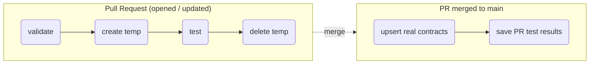

# Data Contract CI/CD — GitHub Actions Demo

This repository demonstrates the Data Contract CI/CD pipeline using the [`data-intelligence-sdk`](https://pypi.org/project/data-intelligence-sdk/) to validate, test, and publish data contracts to an IBM watsonx / Cloud Pak for Data (CPD) project or Data Product Hub (DPH) catalog.

## Repository Layout

```
github-action-demo/
├── .github/
│   ├── workflows/
│   │   ├── data-contract.yml         # Main CI/CD workflow (PR + Merge)
│   │   └── README.md                 # Workflow documentation
│   ├── actions/                      # Composite GitHub Actions
│   │   ├── README.md
│   │   ├── data-contract-validate/
│   │   ├── data-contract-create/
│   │   ├── data-contract-test/
│   │   ├── data-contract-delete/
│   │   └── data-contract-save-results/
│   └── scripts/                      # Python automation scripts
│       ├── README.md
│       ├── contract_utils.py
│       ├── validate_contract.py
│       ├── create_contract.py
│       ├── test_contract.py
│       ├── delete_contract.py
│       └── save_test_results.py
├── contracts/                        # Data contracts (YAML/JSON in ODCS format)
└── README.md
```

## How It Works



- **On Pull Request** (`contracts/**` changed):
  1. **validate**: Validates each contract against the platform API.
  2. **create-temp-contract**: Creates an ephemeral contract (`<name>_PR_<number>`) in the target project.
  3. **test**: Runs data quality rules against the ephemeral contract and attaches results as workflow artifacts.
  4. **delete-temp-contract**: Cleans up ephemeral contracts (runs `always()`).
- **On Push to `main`** (`contracts/**` changed):
  1. Upserts real contracts (in project, or in DPH catalog if `isDPH: "true"`).
  2. Saves test results from the merged PR to the real contracts.

## Setup

### 1. Add Data Contracts
Place ODCS-compliant contract files (YAML/JSON) in the `contracts/` directory. Each contract must specify a `projectId` in `customProperties`:

```yaml
customProperties:
  - property: projectId
    value: <your-cpd-project-id>
```

### 2. Configure Repository Secrets
Go to **Settings → Secrets and variables → Actions → New repository secret** and add:

| Secret | Required | Description |
|---|---|---|
| `PLATFORM_URL` | Yes | CPD / watsonx base URL (e.g. `https://cpd.example.com`). |
| `PLATFORM_API_KEY` | Yes (Cloud) | Platform API key. |
| `PLATFORM_ENV` | No | Deployment type: `ibm_cloud` (default), `aws_cloud`, `gov_cloud`, or `on_prem`. |
| `PLATFORM_USERNAME` | `on_prem` | Username for CPD instance. |
| `PLATFORM_PASSWORD` | `on_prem` | Password for CPD instance. |
| `PLATFORM_ACCOUNT_ID` | `aws_cloud` | Account ID. |
| `IAM_TOKEN_URL` | No | IAM token endpoint for cloud environments. |

### 3. Workflow Permissions
Ensure **Settings → Actions → General → Workflow permissions** allows read and write permissions (specifically `pull-requests: write`, `contents: read`, `actions: read`).
